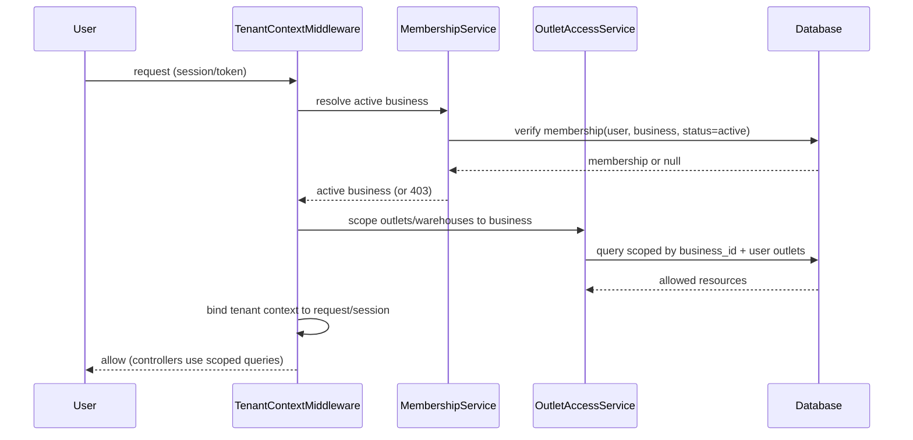

# Multi-Business SaaS Backend Architecture & Implementation Plan — KasirKwu

Dokumen terkait:

- Audit sumber: `docs/architecture/multi-business-tenant-audit.md`
- Matriks kepemilikan data: `docs/architecture/multi-business-data-ownership-matrix.md`
- Rencana pengujian keamanan: `docs/architecture/multi-business-security-test-plan.md`
- Keputusan terbuka: `docs/architecture/multi-business-open-decisions.md`

- **Status:** PERENCANAAN / DOKUMENTASI ONLY — tidak ada perubahan aplikasi, migration, konfigurasi, dependency, atau database.
- **Tanggal:** 2026-10-10
- **Basis:** pembacaan statis source code + verifikasi ulang temuan audit terhadap working tree pada 2026-10-10.
- **Label yang dipakai di seluruh dokumen:**
  - **FAKTA** — terverifikasi di kode/migration.
  - **REKOMENDASI** — usulan desain, belum disetujui.
  - **ASUMSI** — perlu divalidasi.
  - **PERLU KEPUTUSAN** — menunggu konfirmasi pemilik produk.

> Catatan working tree: `git status` menunjukkan sejumlah perubahan/delesi yang **sudah ada sebelumnya** (mis. `app/Http/Controllers/Apps/CustomerController.php`, `ProductController.php`, `database/seeders/RoleSeeder.php`, dan modul DineIn yang dihapus). Perubahan tersebut **bukan hasil tugas ini** dan tidak disentuh. Seluruh nomor baris diverifikasi ulang terhadap kondisi file saat tugas dijalankan.

---

## 1. Ringkasan Eksekutif

**FAKTA.** Aplikasi saat ini adalah sistem **single-tenant, multi-outlet**. Tidak ada entitas `businesses` dan tidak ada kolom `business_id` di seluruh migration. Batas kepemilikan tertinggi adalah `outlets → warehouses`, dengan `user_outlets` sebagai pivot keanggotaan dan Spatie Permission global (`config/permission.php:126` `'teams' => false`).

**FAKTA.** Isolasi saat ini bergantung pada `app/Services/OutletAccessService.php` (`warehousesFor`, `accessibleOutlets`, `activeOutlet`) dan sesi `active_outlet_id` (`app/Http/Controllers/OutletContextController.php`). Sebagian besar modul operasional sudah pyling-scope via `warehouse_id`, tetapi master data (products, customers, suppliers, categories, units, price_lists) bersifat global.

**FAKTA.** Audit menemukan celah lintas-outlet terverifikasi, termasuk `OutletAccessService::warehousesFor()` yang tidak memfilter saat user tidak punya outlet (`app/Services/OutletAccessService.php:77-88`), eskalasi role/outlet di `UserController` (`app/Http/Controllers/UserController.php:79-80,155-156`), agregasi pelanggan global (`app/Http/Controllers/Apps/CustomerController.php:449,460,476`), audience CRM global (`app/Services/CrmAutomationService.php:49`), dan `bank_account_id` tanpa validasi outlet (`app/Services/CheckoutService.php:89`).

**Kesimpulan perencanaan.** Untuk menjadi SaaS multi-business yang aman dibutuhkan: (1) entitas `businesses` + membership, (2) tenant context yang **diverifikasi di server**, (3) `business_id` selektif pada tabel domain, (4) authorization berlapis (middleware + policy + service), dan (5) migrasi bertahap dengan business default untuk instalasi existing. Seluruh langkah itu **belum diimplementasikan** dan hanya direncanakan di dokumen ini.

**Rekomendasi tingkat tinggi (REKOMENDASI):**

1. Gunakan model **membership per business** (`business_user`) sebagai sumber role/status — **bukan** hanya flag global — dan evaluasi Spatie teams sebagai *kemungkinan*, bukan solusi otomatis.
2. Pertahankan `outlets`/`warehouses` sebagai struktur operasional; tambahkan `business_id` sebagai parent.
3. Terapkan **tenant context server-side** yang diverifikasi dari membership, tidak menerima `business_id` mentah dari client.
4. Perbaiki dulu celah kritis pada struktur existing **sebelum** atau **bersamaan** dengan Fase 1, karena celah ini bocor bahkan tanpa multi-business.
5. Pertahankan kompatibilitas shared hosting: query langsung + cache DB, tanpa asumsi queue worker/Redis/WebSocket.

---

## 2. Kondisi Existing yang Terverifikasi

### 2.1 Fakta struktur

| Aspek | Fakta | Bukti |
|---|---|---|
| Entitas business | Tidak ada tabel `businesses`, tidak ada `business_id` | seluruh `database/migrations/` |
| Role/permission | Spatie global, teams disabled, tanpa `team_id` | `config/permission.php:99,126`; `2024_06_13_082620_create_permission_tables.php` |
| Keanggotaan outlet | Pivot `user_outlets(user_id, outlet_id, is_default)` | `database/migrations/2026_09_14_000003_create_user_outlets_table.php` |
| Outlet → warehouse | `warehouses.outlet_id` nullable | `database/migrations/2026_09_14_000002_add_outlet_id_to_warehouses_table.php` |
| Outlet aktif | Sesi `active_outlet_id`, dapat dipaksa shift terbuka | `app/Http/Controllers/OutletContextController.php`; `app/Services/OutletAccessService.php:116-138` |
| Role seed | `super-admin` (semua), `manager` (kecuali admin scopes), `cashier` (daftar eksplisit) | `database/seeders/RoleSeeder.php:61-103` |
| Scoping choke point | `OutletAccessService` | `app/Services/OutletAccessService.php` |
| Kebijakan (Policy) | Tidak ada `app/Policies/` | struktur repo |
| Queue/Job/Event | Tidak ada `app/Jobs`, `app/Events`, `app/Listeners` | struktur repo |
| Scheduled tasks | 4 command | `routes/console.php:11-14` |
| Status transaksi | Hanya `payment_status` (tanpa kolom `status`) | `Transaction` model; `2025_11_19_172346_add_payment_columns_to_transactions_table.php:16` |
| Modul expense | Tidak ada | grep seluruh repo |

### 2.2 Fakta otorisasi & tenancy inti

- **FAKTA.** `warehousesFor()` hanya menambahkan filter `whereIn('outlet_id', ...)` jika user punya outlet (`app/Services/OutletAccessService.php:80-85`). Bila user non-super-admin **tidak punya** assignment outlet, query mengembalikan **semua** warehouse aktif → seluruh data operasional terlihat.
- **FAKTA.** `UserController::store/update` menerima `selectedRoles` dan `outlet_ids` bebas, hanya divalidasi "outlet aktif" (`app/Http/Requests/UserRequest.php:36-41,57-66`), tanpa membatasi ke kewenangan aktor.
- **FAKTA.** `CheckoutService` menetapkan `bank_account_id` dari `$ctx->bankAccountId` untuk `bank_transfer` (`app/Services/CheckoutService.php:87-89`) tanpa memverifikasi kepemilikan outlet; jalur tender memiliki guard (`app/Services/TransactionTenderService.php`).
- **FAKTA.** `CrmAutomationService::buildAudience()` memulai dari `Customer::query()` global (`app/Services/CrmAutomationService.php:49`) tanpa filter outlet/business.
- **FAKTA.** `PosApiController` melookup `Transaction::where('client_uuid', $uuid)` tanpa tenant scope (`app/Http/Controllers/Api/PosApiController.php:743,878`).
- **FAKTA.** `PurchaseOrderController.php:35` dan `GoodsReceivingController.php:56` memakai `orWhereNull('warehouse_id')` langsung.
- **FAKTA.** `AdvancedSalesInsightsController::loyaltyPerformance()` membaca `Customer` dan `LoyaltyPointHistory` global (`app/Http/Controllers/Reports/AdvancedSalesInsightsController.php:685,688`).
- **FAKTA.** `PayableController::store()` membuat payable tanpa `warehouse_id` (`app/Http/Controllers/Apps/PayableController.php:70-86`).

### 2.3 Catatan atas laporan audit

**FAKTA.** Temuan utama laporan audit diverifikasi cocok dengan kondisi kode saat ini. Dua penyesuaian penting:

1. Laporan audit menyebut §7 #6 (bank_transfer) menyandingkan guard di `TransactionTenderService::forOutlet`; verifikasi ulang menegaskan guard hanya ada di jalur **tender**, sedangkan jalur non-tender `bank_transfer` pada `CheckoutService.php:87-89` tidak melewatinya.
2. Working tree memiliki modifikasi pada `CustomerController`, `ProductController`, dan `HandleInertiaRequests` yang **sudah ada** sebelum tugas ini; nomor baris temuan agregasi pelanggan (`CustomerController.php:449,460,476`) tetap valid.

---

## 3. Arsitektur Target

**REKOMENDASI (target).**

```text
Satu aplikasi Laravel + satu frontend Inertia/React + satu database bersama
│
├── Platform (global): users, permissions, roles(opsional teams), regions, jobs, cache
│
└── Business (tenant root)
    ├── Membership (business_user): user_id, business_id, role, status, default_outlet_id
    ├── Outlet (business_id) ── Warehouse (outlet_id)
    ├── Master data per business: products, categories, customers, suppliers, units, price_lists
    └── Operasional per warehouse: transactions, carts, stock, shifts, PO, GR, returns, receivables, payables, sales_returns, expenses
```

Prinsip:

- `Business` = batas kepemilikan data & laporan.
- `Outlet` = cabang; `Warehouse` = lokasi stok (struktur existing dipertahankan).
- `business_id` ditempel **selektif** (lihat matriks), bukan ke semua tabel.
- `super-admin` = operator platform; `Owner` = membership bisnis.

**PERLU KEPUTUSAN.** Definisi `Owner`/`Manager`/`Staff` sebagai role bisnis dan apakah `super-admin` tetap global (lihat `multi-business-open-decisions.md`).

---

## 4. Diagram Relasi Entitas (Mermaid)

```mermaid
erDiagram
    USERS ||--o{ BUSINESS_USER : "membership"
    BUSINESSES ||--o{ BUSINESS_USER : "has members"
    BUSINESSES ||--o{ OUTLETS : "owns"
    OUTLETS ||--o{ WAREHOUSES : "has"
    BUSINESSES ||--o{ PRODUCTS : "owns"
    BUSINESSES ||--o{ CATEGORIES : "owns"
    BUSINESSES ||--o{ CUSTOMERS : "owns"
    BUSINESSES ||--o{ SUPPLIERS : "owns"
    BUSINESSES ||--o{ UNITS : "owns"
    BUSINESSES ||--o{ PRICE_LISTS : "owns"
    BUSINESSES ||--o{ EXPENSES : "owns"
    WAREHOUSES ||--o{ TRANSACTIONS : "records"
    WAREHOUSES ||--o{ CARTS : "records"
    WAREHOUSES ||--o{ STOCK_MUTATIONS : "records"
    WAREHOUSES ||--o{ CASHIER_SHIFTS : "records"
    WAREHOUSES ||--o{ PURCHASE_ORDERS : "records"
    WAREHOUSES ||--o{ GOODS_RECEIVINGS : "records"
    WAREHOUSES ||--o{ STOCK_OPNAMES : "records"
    WAREHOUSES ||--o{ SALES_RETURNS : "records"
    WAREHOUSES ||--o{ SUPPLIER_RETURNS : "records"
    WAREHOUSES ||--o{ PRODUCT_BATCHES : "records"
    PRODUCTS ||--o{ TRANSACTION_DETAILS : "sold as"
    PRODUCTS ||--o{ PRODUCT_WAREHOUSE : "stocked in"
    WAREHOUSES ||--o{ PRODUCT_WAREHOUSE : "holds"
    TRANSACTIONS ||--o{ TRANSACTION_DETAILS : "contains"
    TRANSACTIONS ||--o{ TRANSACTION_TENDERS : "paid via"
    TRANSACTIONS ||--o{ PROFITS : "yields"
    TRANSACTIONS ||--o{ SALES_RETURNS : "returned by"
    TRANSACTIONS ||--o| RECEIVABLES : "may create"
    CUSTOMERS ||--o{ RECEIVABLES : "owes"
    SUPPLIERS ||--o{ PAYABLES : "owed"
    OUTLETS ||--o{ BANK_ACCOUNTS : "owns"
    OUTLETS ||--o{ PAYMENT_SETTINGS : "configures"
    OUTLETS ||--o{ PRICING_RULES : "scopes"
    OUTLETS ||--o{ DINE_AREAS : "scopes"
    CUSTOMERS ||--o{ LOYALTY_POINT_HISTORIES : "earns"
    CUSTOMERS ||--o{ CUSTOMER_VOUCHERS : "holds"
    CUSTOMER_SEGMENTS ||--o{ CUSTOMER_SEGMENT_MEMBERSHIPS : "groups"
    CUSTOMERS ||--o{ CUSTOMER_SEGMENT_MEMBERSHIPS : "member of"
    CUSTOMER_CAMPAIGNS ||--o{ CUSTOMER_CAMPAIGN_LOGS : "sends"
```



**FAKTA.** Entitas `BUSINESSES`, `BUSINESS_USER`, dan `EXPENSES` belum ada; sisanya mengikuti schema existing pada `database/migrations/`.

### 4.1 Alur tenant context (Mermaid sequence)



---

## 5. Model Membership dan Role

**FAKTA.** Tidak ada mekanisme membership business saat ini; role bersifat global via Spatie.

**REKOMENDASI — pilihan model role:**

| Opsi | Deskripsi | Kelebihan | Kekurangan | Catatan pada kode existing |
|---|---|---|---|---|
| A. Membership role column | `business_user.role` (string/enum) + permission tetap Spatie global | sederhana; role per business eksplisit; tidak mengubah skema Spatie | perlu pemetaan membership→Spatie role saat runtime | `User::hasPermissionTo()` (`app/Models/User.php:104-120`) perlu konteks bisnis aktif |
| B. Spatie teams | Aktifkan `teams` + `team_id` = `business_id` | memakai fitur paket; role per team native | butuh migrasi ulang tabel Spatie; `team_id` harus di-set tiap request; berisiko jika context salah set | `config/permission.php:126`; migration `2024_06_13_082620` |
| C. Spatie role per business (role name berkode business) | Role global tetapi unik per business (mis. `business-12-manager`) | tidak perlu teams | meledakkan jumlah role; sulit dikelola | `RoleSeeder` membuat role global |

**REKOMENDASI.** Mulai dengan **Opsi A** (membership menyimpan role bisnis), lalu gunakan Spatie Permission sebagai *ability* di dalam business terverifikasi (mis. saat context aktif, tetapkan team role atau filter permission berdasarkan membership). Opsi B dievaluasi hanya jika Opsi A terbukti kurang; **jangan mengasumsikan Spatie teams otomatis menyelesaikan isolasi** — teams hanya mengelompokkan role, bukan mengamankan query.

**Model membership yang diusulkan (REKOMENDASI):**

```text
users (global)
  id, name, email, password, locale, completed_tours, ...

businesses
  id, name, slug, owner_user_id, status, currency, timezone, created_at

business_user  (membership)
  id
  business_id  FK -> businesses
  user_id       FK -> users
  role          enum(owner, manager, staff)     # atau role_id
  status        enum(invited, active, suspended, revoked)
  default_outlet_id  FK -> outlets (nullable)
  invited_by_user_id FK -> users (nullable)
  invited_at, joined_at
  UNIQUE(business_id, user_id)
```

**Aturan (REKOMENDASI):**

- Satu user boleh punya banyak membership, role berbeda per business.
- `status=active` adalah syarat akses; `invited`/`suspended`/`revoked` ditolak.
- `user_outlets` tetap sebagai pembatas outlet **di dalam** business; validasi: outlet harus milik business aktif.
- Role global `super-admin` tidak dipakai untuk bisnis; hanya operator platform.
- Permission Spatie tetap menjadi katalog ability; evaluasi permission dilakukan **setelah** membership & business aktif terverifikasi.

**PERLU KEPUTUSAN.** Apakah role disimpan di membership saja, atau membership mereferensikan Spatie `role_id` (memungkinkan permission custom per business).

---

## 6. Matriks Akses Owner / Manager / Staff / Super-admin

Target akses (REKOMENDASI; menunggu konfirmasi):

| Kemampuan | Super-admin (platform) | Owner | Manager | Staff |
|---|---|---|---|---|
| Kelola business platform | Ya | - | - | - |
| Buat/nonaktifkan business | Ya | Opsi: buat miliknya | Tidak | Tidak |
| Lihat semua business | Ya (operasional platform, teraudit) | Hanya miliknya | Hanya yang dikelola | Tidak |
| Laporan gabungan lintas business | Ya | Ya (miliknya) | Tidak (per business) | Tidak |
| Kelola membership & role bisnis | Ya | Ya | Terbatas (ajak staff, tanpa owner) | Tidak |
| Kelola master data (produk, harga) | Ya | Ya | Ya (sesuai permission) | Sesuai permission |
| Operasional POS (transaksi, shift) | Ya | Ya | Ya | Ya (outlet/warehouse terbatas) |
| Lihat laporan keuangan business | Ya | Ya | Sesuai permission | Tidak |
| Pengaturan gateway pembayaran | Ya | Ya | Opsi (tanpa secret) | Tidak |
| Akses API/token | Ya | Ya | Sesuai ability | Sesuai ability |

**FAKTA acuan permission existing:** `database/seeders/PermissionSeeder.php`; pembatasan manager pada `RoleSeeder.php:92-103`; `cashier` pada `RoleSeeder.php:64-81`.

**REKOMENDASI.** Jangan menjadikan nama role sebagai otorisasi. Otorisasi = `membership.status=active` + `business_id` record = business aktif + permission ability + batas outlet/warehouse.

---

## 7. Strategi Tenant Context dan Authorization

### 7.1 Komponen yang diusulkan (REKOMENDASI)

- **`BusinessContext` / `TenantContext` (singleton per request)** menyimpan `business_id`, `membership`, `accessibleOutletIds`.
- **`ResolveBusinessContext` middleware** (web + api) menetapkan konteks dari:
  - user login + membership aktif,
  - pilihan business aktif (session untuk web; token/session untuk API),
  - validasi `business_id` tidak boleh datang mentah dari client tanpa verifikasi membership.
- **`BusinessPolicy` / `OutletPolicy` / `WarehousePolicy`** untuk aksi per-record.
- **Service-layer guard** (mis. perluas `OutletAccessService` atau `TenantAccessService`) untuk validasi FK dan scope.
- **Global scope (opsional)** `BelongsToBusiness` untuk model domain ber-`business_id`, **hanya jika** context selalu tersedia; jika tidak, gunakan scoping eksplisit untuk menghindari query tanpa filter saat context kosong.

Perbandingan:

| Pendekatan | Kelebihan | Risiko |
|---|---|---|
| Global scope | otomatis, sulit lupa filter | jika context null/unset, bisa membocorkan atau memblokir; memengaruhi console/job |
| Scoping eksplisit (query/service) | terkontrol, mudah diaudit | bergantung disiplin pemanggil |
| Middleware + policy + service | berlapis, sesuai struktur existing | lebih banyak kode |

**REKOMENDASI.** Kombinasi: middleware menetapkan context, policy/service melakukan validasi per-record, dan **scoping eksplisit** sebagai default. Global scope ditambahkan belakangan untuk model tertentu setelah context terbukti selalu tersedia (termasuk di command/API), agar tidak menimbulkan kegagalan senyap pada job/scheduler.

### 7.2 Alur aman

1. Login → validasi user.
2. Resolve membership aktif (business yang diizinkan).
3. Pilih/redirect business (web: session; API: parameter tervalidasi/token claim; job: argumen eksplisit).
4. Tetapkan `BusinessContext` pada request.
5. Validasi outlet/warehouse terhadap business aktif.
6. Semua query tulis/baca dibatasi business aktif; FK request divalidasi ke `business_id` yang sama.
7. Ganti business aktif tidak mem-bypass authorization (re-verify membership tiap request).
8. Job/API/webhook/scheduler **tidak** bergantung session browser; membawa `business_id` yang tervalidasi secara eksplisit.

**REKOMENDASI.** Untuk API, tambahkan claim/business context pada token atau header `X-Business-Id` yang diverifikasi ke membership. Untuk webhook, verifikasi melalui relasi record (bukan input client). Untuk job, iterasi per business secara eksplisit.

### 7.3 Penanganan super-admin

**FAKTA.** `User::isSuperAdmin()` bypass permission (`app/Models/User.php:104-120`); `OutletAccessService` memberi akses semua outlet ke super-admin (`app/Services/OutletAccessService.php:27,80,92,105`).

**REKOMENDASI.** Super-admin platform tetap boleh lintas business, tetapi:
- semua akses lintas business dicatat (audit),
- default UI/aksinya per business (context), bukan "semua sekaligus" agar tidak tidak sengaja mengubah data salah business,
- dilarang menghapus super-admin terakhir (sudah ada guard di `UserController.php:215-237`).

### 7.4 Audit logging

**FAKTA.** `AuditLogService` ada (`app/Services/AuditLogService.php`) dan dipakai di `UserController`. **REKOMENDASI.** Tambahkan `business_id` pada konteks audit dan catat pergantian business aktif/membership.

---

## 8. Pemetaan Tabel dan Kepemilikan Data

Ringkasan di sini; detail lengkap ada di `docs/architecture/multi-business-data-ownership-matrix.md`.

| Kelompok | Tabel contoh | Strategi isolasi (REKOMENDASI) |
|---|---|---|
| Global platform | `users`, `roles`, `permissions`, `personal_access_tokens`, region, `jobs`, `cache`, `sessions` | tanpa `business_id` |
| Milik business (master) | `products`, `categories`, `customers`, `suppliers`, `units`, `price_lists`, `expenses` | `business_id` langsung + unique per business |
| Milik outlet | `pricing_rules`, `bank_accounts`, `payment_settings`, `dine_areas`, `customer_campaigns`, `customer_vouchers` | tetap `outlet_id`; tambah `business_id` untuk filter cepat |
| Milik warehouse (operasional) | `transactions`, `carts`, `stock_mutations`, `cashier_shifts`, `purchase_orders`, `goods_receivings`, `stock_opnames`, `sales_returns`, `supplier_returns`, `product_batches`, `stock_transfers` | `warehouse_id` + `business_id` denormal |
| Turunan | `transaction_details`, `transaction_tenders`, `profits`, `loyalty_point_histories`, `customer_credits`, `receivable_payments`, `payable_payments` | ikut induk; hindari `business_id` ganda |
| Perlu investigasi | `settings` (global vs business), `audit_logs`, `webhook` lookup, idempotency `client_uuid` | lihat matriks + keputusan terbuka |

**REKOMENDASI unique constraint per business:** `outlets.code`, `warehouses.code`, `products.barcode`, `products.sku`, `customers.member_code`, `settings(key)` (per business, bukan global).

---

## 9. Strategi Migrasi dan Backfill

**FAKTA.** Database existing harus dipertahankan; tidak ada entitas business.

**REKOMENDASI urutan migrasi (schema + backfill), tiap langkah punya `down()`:**

1. **Fase schema:** buat `businesses`, `business_user`.
2. **Seed business awal:** buat 1 business default untuk instalasi existing (nama dari `Setting::get('store_name')`).
3. **Tambah kolom nullable** `business_id` pada tabel terpilih (mulai nullable, tanpa constraint ketat).
4. **Backfill:** assign `business_id` business default; untuk tabel operasional, turunkan dari `warehouse → outlet → business`.
5. **Buat membership owner:** user yang punya akses outlet → `business_user(role=owner/manager/staff)` sesuai pemetaan yang dikonfirmasi.
6. **Tambah FK + index** `business_id`.
7. **Tighten unique** (outlet code, product barcode, dll) menjadi per-business setelah verifikasi tidak ada duplikat.
8. **Tighten NOT NULL** `business_id` setelah 100% terisi (feature-flag transisi).
9. **Middleware `business.required`** menolak operasi bila business belum di-mapping (mode multi-business).

**Pemetaan data lama (REKOMENDASI default):**

- Semua outlet existing → business default **kecuali** diputuskan lain (lihat `multi-business-open-decisions.md` Q7).
- Transaksi/produk/customer/supplier lama → business default.
- `user_outlets` → dipertahankan; membership dibentuk dari pasangan (user, business) outlet yang diakses.
- Data yatim: `warehouses.outlet_id IS NULL` (PUSAT legacy), `settings.outlet_id IS NULL`, produk tanpa pivot.

**Pemeriksaan integritas sebelum/sesudah:**

- `php artisan outlet:audit`, `php artisan outlet:legacy-audit`, `php artisan inventory:reconcile` (read-only).
- Checksum: `COUNT(*)` dan `SUM(grand_total)` per outlet/business sebelum vs sesudah.
- Deteksi duplikat unique yang akan di-tighten.

**Backup/staging/rollback:**

- `mysqldump` penuh + verifikasi restore ke staging.
- Dry-run pada kloning DB staging.
- Simpan snapshot kolom `business_id` sebelum tighten.
- Kriteria penghentian: jika ada baris tanpa mapping, atau checksum beda → **stop**, rollback, investigasi.

**Operasi selama transisi (REKOMENDASI):** aplikasi tetap single-business (business default) dengan `business_id` terisi; fitur multi-business diaktifkan setelah semua baris ter-mapping dan middleware aktif.

---

## 10. Daftar Risiko Keamanan

Ringkasan; detail test di `multi-business-security-test-plan.md`. Prioritas: P0 kritis, P1 tinggi, P2 sedang.

| # | Prio | Risiko | Bukti (terverifikasi) | Prasyarat perbaikan |
|---|---|---|---|---|
| 1 | P0 | User tanpa outlet melihat semua warehouse | `app/Services/OutletAccessService.php:77-88` | context business + aturan "tanpa assignment = kosong" |
| 2 | P0 | Eskalasi role/outlet via user management | `app/Http/Controllers/UserController.php:79-80,155-156`; `app/Http/Requests/UserRequest.php:36-41,57-66` | policy + batas role per membership |
| 3 | P1 | Riwayat/statistik customer lintas outlet | `app/Http/Controllers/Apps/CustomerController.php:449,460,476` | scoping business + customer per business |
| 4 | P1 | Loyalty global di insights | `app/Http/Controllers/Reports/AdvancedSalesInsightsController.php:685,688` | scoping business |
| 5 | P1 | CRM audience global | `app/Services/CrmAutomationService.php:49` | filter business di `buildAudience` |
| 6 | P1 | `bank_account_id` non-tender tanpa guard | `app/Services/CheckoutService.php:87-89` | validasi `bank_accounts` → business aktif |
| 7 | P1 | POS no-shift: produk/scan global | `app/Http/Controllers/Api/PosApiController.php:147-158,188` | scope warehouse/business |
| 8 | P1 | Product list/resource global + stok agregat | `app/Http/Controllers/Apps/ProductController.php`; `app/Http/Resources/ProductResource.php` | product per business |
| 9 | P1 | Idempotensi `client_uuid` global | `app/Http/Controllers/Api/PosApiController.php:743,878` | lookup ter-scope business |
| 10 | P2 | `orWhereNull('warehouse_id')` langsung | `PurchaseOrderController.php:35`; `GoodsReceivingController.php:56` | guard single-outlet / business |
| 11 | P2 | Payable tanpa warehouse | `app/Http/Controllers/Apps/PayableController.php:70-86` | isi `warehouse_id`/`business_id` |
| 12 | P2 | Dropdown laporan global | `Reports/SalesReportController`, `ProfitReportController`, `AdvancedSalesInsightsController` | scope business |
| 13 | P2 | Import/export produk & customer global | `app/Imports/ProductsImport.php`; `app/Exports/ProductsExport.php`; `app/Exports/CustomersExport.php` | scope per business |
| 14 | P2 | Cart dibaca tanpa scope eksplisit | `app/Http/Controllers/Api/PosApiController.php` (cart reads) | scope user + business |
| 15 | P2 | Scheduler CRM/reorder global | `routes/console.php:11-14`; `app/Services/CrmAutomationService.php` | iterasi per business |
| 16 | U | Webhook lintas business | `app/Http/Controllers/Api/PaymentWebhookController.php:66-99,190-220` | uji + scope reference |
| 17 | U | `active_outlet_id` vs business aktif | `app/Http/Controllers/OutletContextController.php`; `OutletAccessService::activeOutlet` | desain context business |

**Catatan penting.** Semua risiko di atas **belum diperbaiki**; dokumen ini hanya merencanakan perbaikannya. Jangan mengklaim aman hanya karena ada role/permission.

---

## 11. Strategi Laporan dan Performa

**FAKTA.** Status transaksi hanya `payment_status` (`paid`, `unpaid`, `pending`, `pending_approval`, `failed`) — tidak ada kolom `status`. Hitungan saat ini memakai semua baris: `app/Http/Controllers/DashboardController.php:44`, `app/Http/Controllers/Reports/SalesReportController.php:54-58`.

**REKOMENDASI definisi (menunggu keputusan):**

- Transaksi selesai = `payment_status = 'paid'` (default usulan).
- Piutang (`pay_later`) dihitung terpisah; `pending`/`pending_approval`/`failed` dikeluarkan dari omzet "selesai" kecuali dikonfirmasi.
- Pendapatan bersih = `SUM(grand_total)` transaksi selesai − retur (`sales_returns.status = 'completed'`).
- Laba kotor = `SUM(profits.total)` transaksi selesai.

**Laporan Owner lintas business (REKOMENDASI):**

- Query langsung ter-scope `whereIn('business_id', ownerBusinessIds)`; gunakan agregasi SQL (`SUM`, `COUNT`) bukan load koleksi.
- Ringkasan per business & per outlet: `GROUP BY business_id`, `GROUP BY outlet_id`.
- Zona waktu: gunakan timezone business/toko (`Setting` existing) untuk boundary tanggal, bukan asumsi UTC.
- Batas tenant: laporan hanya menggabungkan business dengan membership aktif milik user.

**Performa shared hosting (REKOMENDASI):**

- **Tidak** mengasumsikan queue worker/Redis/WebSocket. Gunakan driver cache database (`cache` table sudah ada).
- Cache aggregate laporan dengan TTL pendek + invalidasi saat transaksi selesai.
- Polling ringan untuk status pembayaran sudah tersedia (`transactions/{invoice}/status`).
- Scheduler: `schedule:run` per menit; command harus iterasi per business (bukan global).

---

## 12. Tahapan Implementasi

Setiap fase: tujuan, file terdampak, prasyarat, risiko, test wajib, kriteria penerimaan, rollback, dependency.

### Fase 0 — Keputusan, Backup, Baseline Test
- **Tujuan:** kunci keputusan (`multi-business-open-decisions.md`), backup penuh, baseline test hijau.
- **File:** dokumentasi; tidak ada kode.
- **Prasyarat:** tidak ada.
- **Risiko:** keputusan belum final → rework.
- **Test wajib:** `php artisan test` baseline.
- **Kriteria:** semua keputusan P0 terjawab; backup terverifikasi.
- **Rollback:** tidak ada perubahan.
- **Dependency:** —

### Fase 1 — Tenant Schema & Membership
- **Tujuan:** tabel `businesses`, `business_user`; business default.
- **File:** `database/migrations/`, `app/Models/Business.php`, `app/Models/BusinessUser.php` (baru), seeder.
- **Prasyarat:** Fase 0.
- **Risiko:** unique/index; migrasi di DB large.
- **Test wajib:** migrasi up/down; membership unique.
- **Kriteria:** skema terpasang, business default dibuat, belum ada perubahan perilaku.
- **Rollback:** `migrate:rollback` (kolom baru belum dipakai).
- **Dependency:** Fase 0.

### Fase 2 — Tenant Context & Authorization
- **Tujuan:** middleware context, `TenantAccessService`, policy, validasi FK.
- **File:** `app/Http/Middleware/`, `bootstrap/app.php`, `app/Policies/` (baru), `app/Services/`, `app/Models/User.php`, `config/permission.php` (evaluasi).
- **Prasyarat:** Fase 1.
- **Risiko:** regresi semua route; context null di job/console.
- **Test wajib:** test plan keamanan bagian akses tanpa membership, ganti ID.
- **Kriteria:** konteks terverifikasi server; request tanpa membership ditolak.
- **Rollback:** feature-flag bypass context (single-business).
- **Dependency:** Fase 1.

### Fase 3 — Backfill & Kompatibilitas Instalasi Existing
- **Tujuan:** isi `business_id` lama; tighten unique.
- **File:** migration backfill + command audit (baru).
- **Prasyarat:** Fase 1-2.
- **Risiko:** data yatim, checksum beda.
- **Test wajib:** audit counts sebelum/sesudah; `inventory:reconcile`.
- **Kriteria:** 100% terisi, checksum sama, unique per business.
- **Rollback:** snapshot + migration down.
- **Dependency:** Fase 1-2.

### Fase 4 — Isolasi Master Data
- **Tujuan:** products/categories/customers/suppliers/units/price_lists per business.
- **File:** controller/service/resource di `app/Http/Controllers/Apps/`, `app/Services/`, `app/Imports`, `app/Exports`, model scope.
- **Prasyarat:** Fase 2-3.
- **Risiko:** POS tidak menemukan produk; impor menimpa data.
- **Test wajib:** isolasi produk/customer lintas business.
- **Kriteria:** tidak ada data master lintas business.
- **Rollback:** flag scoping.
- **Dependency:** Fase 2-3.

### Fase 5 — Isolasi POS, Transaksi, Stok, Pembayaran
- **Tujuan:** transaksi/cart/stok/shift/PO/GR/retur/bank account/expense ter-scope.
- **File:** `CheckoutService`, `PosApiController`, `TransactionController`, `CashierShiftService`, `StockTransferService`, layanan purchasing, `TransactionTenderService`, `PayableController`.
- **Prasyarat:** Fase 2-4.
- **Risiko:** transaksi gagal; stok negatif.
- **Test wajib:** concurrency + isolasi business.
- **Kriteria:** checkout per business aman; bank account tervalidasi.
- **Rollback:** flag.
- **Dependency:** Fase 2-4.

### Fase 6 — Laporan Owner & Agregasi Lintas Bisnis
- **Tujuan:** definisi completed; laporan lintas business (owner).
- **File:** `DashboardController`, `Reports/*`, `CashierShiftService`.
- **Prasyarat:** Fase 5 + keputusan status.
- **Risiko:** angka tidak cocok dengan ekspektasi.
- **Test wajib:** hitung hanya `paid`; laporan gabungan hanya business milik owner.
- **Kriteria:** metrik konsisten & ter-scope.
- **Rollback:** revert query.
- **Dependency:** Fase 5.

### Fase 7 — Import/Export, CRM, Jobs, API, Webhook
- **Tujuan:** isolasi jalur non-interaktif & bulk.
- **File:** `app/Imports`, `app/Exports`, `CrmAutomationService`, `routes/console.php`, `app/Console/Commands`, `routes/api.php`, `PaymentWebhookController`.
- **Prasyarat:** Fase 4-6.
- **Risiko:** job lintas business; webhook salah record.
- **Test wajib:** test plan job/api/webhook.
- **Kriteria:** setiap job membawa business tervalidasi.
- **Rollback:** flag per job.
- **Dependency:** Fase 4-6.

### Fase 8 — Integrasi UI/UX, Pengujian, Deployment Bertahap
- **Tujuan:** business switcher, onboarding, rollout.
- **File:** `resources/js/Components/Dashboard/`, `HandleInertiaRequests`, halaman setup.
- **Prasyarat:** Fase 1-7.
- **Risiko:** kebingungan user; caching.
- **Test wajib:** regresi penuh + manual QA.
- **Kriteria:** semua kriteria §13 terpenuhi.
- **Rollback:** rollback rilis + flag.
- **Dependency:** Fase 1-7.

---

## 13. Kriteria Penerimaan

- Tenant context diverifikasi server untuk web, API, job, webhook.
- User tanpa membership tidak bisa mengakses data business apa pun.
- Owner A tidak bisa membaca/mengubah business Owner B melalui ID/tampering.
- Satu user multi-business dengan role berbeda berfungsi tanpa kebocoran.
- Semua master data & operasional ter-scope `business_id`.
- FK request tervalidasi ke business aktif.
- Import/export, laporan, dropdown, POS lookup, idempotency, webhook ter-scope.
- Laporan owner hanya menggabungkan business miliknya.
- Tidak ada regresi fungsi POS existing (baseline test hijau).
- Data lama ter-backfill 100% dengan checksum sama.
- Perubahan tidak memerlukan infrastruktur di luar shared hosting.

---

## 14. Rencana Pengujian dan Rollback

- **Pengujian:** lihat `docs/architecture/multi-business-security-test-plan.md` (skenario akses tanpa membership, ganti ID, role berbeda, outlet/warehouse tidak sah, FK, query/laporan/dropdown, import/export, transaksi/stok, pembayaran/bank account, idempotency, job/API/webhook/scheduler, owner report, super-admin, regresi POS).
- **Baseline:** jalankan `php artisan test` sebelum perubahan; simpan hasil.
- **Rollback:** setiap migration punya `down()`; feature-flag untuk scoping/context; snapshot sebelum tighten; prosedur restore `mysqldump`.
- **Gate:** migrasi hanya lanjut bila audit/checksum lolos.

---

## 15. Keputusan Terbuka

Lihat rincian lengkap di `docs/architecture/multi-business-open-decisions.md`. Ringkas:

1. Definisi transaksi selesai (usulan `paid`).
2. Apakah `super-admin` tetap operator platform.
3. Role berbeda per business (ya/tidak) & mekanisme.
4. Isolasi master data penuh atau boleh berbagi.
5. Setting global vs per business.
6. Pembuatan business: self-service owner atau admin platform.
7. Outlet existing → satu business atau beberapa.
8. Batasan shared hosting (queue, scheduler, cache).
9. Penanganan data existing yang tidak bisa dipastikan ownership.

Tidak ada keputusan di atas yang berstatus "approved" pada dokumen ini.

---

## 16. Daftar File Existing yang Kemungkinan Terdampak

**Tenancy & authz**
- `app/Services/OutletAccessService.php`
- `app/Http/Controllers/OutletContextController.php`
- `app/Http/Middleware/HandleInertiaRequests.php`
- `app/Http/Middleware/EnsureActiveCashierShift.php`
- `app/Models/User.php`, `app/Models/Outlet.php`, `app/Models/Warehouse.php`
- `app/Http/Controllers/UserController.php`, `app/Http/Controllers/RoleController.php`, `app/Http/Requests/UserRequest.php`
- `bootstrap/app.php`, `config/permission.php`, `config/security.php`
- `app/Providers/AppServiceProvider.php`

**Master data**
- `app/Http/Controllers/Apps/ProductController.php`, `CategoryController.php`, `CustomerController.php`, `SupplierController.php`, `MemberController.php`, `UnitController.php`, `PriceListController.php`, `PricingRuleController.php`
- `app/Http/Resources/ProductResource.php`
- `app/Imports/ProductsImport.php`, `app/Imports/CustomersImport.php`
- `app/Exports/ProductsExport.php`, `app/Exports/CustomersExport.php`, `app/Exports/TransactionsExport.php`

**Transaksi & operasional**
- `app/Http/Controllers/Apps/TransactionController.php`
- `app/Http/Controllers/Api/PosApiController.php`
- `app/Services/CheckoutService.php`, `CashierShiftService.php`, `StockMutationService.php`, `StockTransferService.php`, `PurchaseOrderService.php`, `GoodsReceivingService.php`, `SupplierReturnService.php`, `TransactionTenderService.php`
- `app/Http/Controllers/Apps/PayableController.php`, `ReceivableController.php`, `StockOpnameController.php`, `SalesReturnController.php`, `CashierShiftController.php`, `PurchaseOrderController.php`, `GoodsReceivingController.php`

**Laporan**
- `app/Http/Controllers/DashboardController.php`
- `app/Http/Controllers/Reports/SalesReportController.php`, `ProfitReportController.php`, `AdvancedSalesInsightsController.php`

**CRM/Loyalty & pembayaran**
- `app/Services/CrmAutomationService.php`, `LoyaltyService.php`, `CustomerSegmentationService.php`, `PriceListService.php`
- `app/Http/Controllers/Api/PaymentWebhookController.php`
- `app/Http/Controllers/Apps/PaymentSettingController.php`, `BankAccountController.php`

**Job/Command/Seeder**
- `app/Console/Commands/GenerateReorderCommand.php`, `CrmGenerateRemindersCommand.php`, `CrmSyncSegmentsCommand.php`, `ExpirePendingTransactionsCommand.php`
- `routes/console.php`
- `database/seeders/RoleSeeder.php`, `PermissionSeeder.php`, `UserSeeder.php`, `DemoOutletSeeder.php`, `DatabaseSeeder.php`

**Frontend**
- `resources/js/Components/Dashboard/OutletSwitcher.jsx`, `Navbar.jsx`
- `resources/js/Utils/Menu.jsx`, `resources/js/Utils/offlineDb.js`
- `resources/js/Pages/Setup/Wizard.jsx`, `resources/js/Pages/Dashboard/Users/*`
